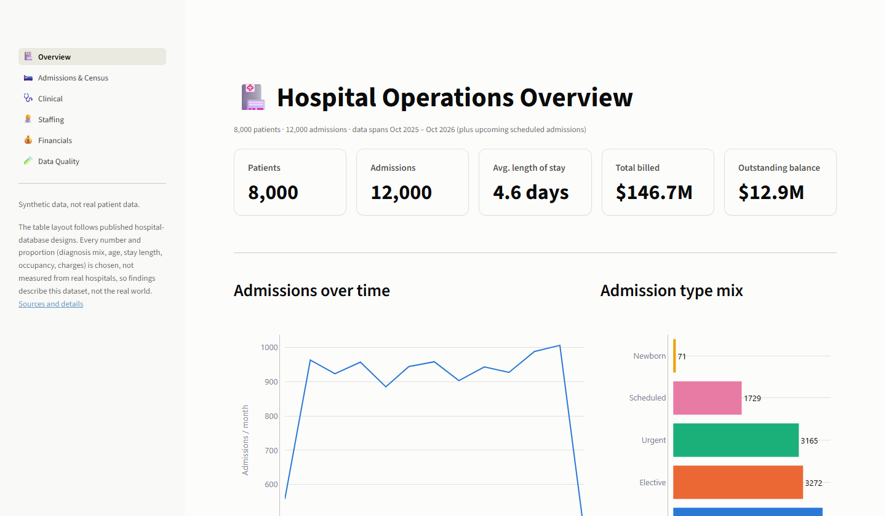

# Synthetic Hospital Database



https://synthetic-hospital-db.streamlit.app/ (the free tier sleeps when idle: click **Yes, get this app back up!** and give it a few seconds)

A fully synthetic, US-style hospital database for practising SQL and analytics: 17 linked tables holding one year of admissions (13 October 2025 to 13 October 2026) at a hospital with 212 inpatient beds, and no real patient data.

## Headline

At the largest size (12,000 admissions, 8,000 patients), the generator's output broke 59 consistency rules 71 times before the repair step and none after; all 71 are one rule (a newborn's registration date), the only thing repair changes. The rules are ones I wrote, so they show that the tables agree with each other, not that the data is clinically realistic. Beds are 65% occupied on average (about 137 of 212 at midnight, after a 45-day warm-up), and 22.5% of the 10,844 admissions that needed a bed waited for one.

## Who's this for?

People practising SQL and analytics on a hospital database whose tables join cleanly, such as learners and interview candidates, and readers who want to see how synthetic data is generated, checked and repaired

## What can it do?

It can answer these questions, in SQL or on the dashboard:

1. What are the five most common diagnoses in each department, with their names? (89 rows)
2. How much was billed in each department each month? (253 rows)
3. How many patients are in a bed at midnight each day, and what share of the inpatient beds is that? (366 rows; the dashboard's Admissions & Census page shows it)

[practice/questions.md](practice/questions.md) has 18 questions from one table up to window functions and four data-quality checks that should return no rows; [practice/solutions.sql](practice/solutions.sql) has the answers, kept apart.

## How to use it?

Load the CSVs into SQLite and work through the questions, or open the dashboard (six pages; every chart has a "View as table"). The Data Quality page shows all 59 checks, before and after repair.

## Data

| Source | What |
|---|---|
| This repository | 17 tables, 197,512 rows, from [Faker](https://faker.readthedocs.io/) (names, addresses, dates) and weighted random draws (everything clinical and financial); MIT licence |
| ICD-10-CM ([International Classification of Diseases, 10th Revision, Clinical Modification](https://www.cdc.gov/nchs/icd/icd-10-cm.htm)) | 66 real diagnosis codes with hand-set weights; published by the CDC (Centers for Disease Control and Prevention) |
| CPT (Current Procedural Terminology) | 30 real procedure code numbers with names written for this project; CPT is copyrighted by the American Medical Association (AMA) and its descriptors are not reproduced |
| Five hospital-database designs | the table and field layout ([docs/CITATIONS.md](docs/CITATIONS.md)) |

One admission is one row of `admissions`. The CSVs in `app/data/` come from one pinned run (reference date 2026-10-13 12:00:00); their SHA-256 values are in `app/data/checksums.json`. Only the large size ships; small (800 admissions) and medium (3,200) exist only if you generate them.

## Reading the numbers

- **Admissions and stays.** The 12,000 admissions are 10,623 discharged, 170 still admitted, 592 scheduled (after the reference date, up to 11 January 2027) and 615 cancelled; 51 of the cancelled had no bed free in time and the rest were drawn as cancelled. A "stay" is an admission that happened: the 10,793 admitted or discharged.
- **Occupancy.** Census is the patients in an inpatient bed at midnight; bed occupancy is census divided by inpatient beds. Averages leave out the first 45 days, because the hospital starts empty.
- **Rates.** Every waiting rate is a share of the 10,844 admissions that needed a bed (the 10,793 stays plus the 51 cancelled for lack of one): 22.5% waited, 1.2% were placed at a lower level of care, 0.47% were cancelled.
- **Gender and sex at birth.** Two fields. The rules about pregnancy, prostate disease, deliveries and Pap smears use sex at birth. For M and F patients the two agree; for NB (non-binary) patients sex at birth is drawn 50/50.
- **Age.** `patients.age` is the age when the data was generated; the treatment rules use age at admission.
- **Structure is sourced, numbers are chosen.** Every proportion and amount (diagnosis mix, age, stay length, occupancy targets, charges) is a setting I chose, not a measurement of real hospitals; findings describe this dataset.

[docs/METHODOLOGY.md](docs/METHODOLOGY.md) defines every term and lists the checks, the rounds of fixes and the reproducibility steps.

## What the data shows

- **The checks catch what the first generator got wrong.** The first generator's output had 99,532 violations on the 51 checks that existed then (6,177 at small size, 25,681 at medium); the current one has 71, then 0 after repair. The check sets differ, so the totals show direction, not a like-for-like rate.
- **Every check can fail.** For 56 of the 59 rules a test injects one violation and the check reports it; for the other 3 the table's own `CHECK` constraint rejects the row.
- **Keeping rooms within capacity costs waiting.** At large size 2,444 admissions (22.5%) waited for a bed, for a mean of 45 hours. Rooms are sized by a planned occupancy I chose, so the figure shows what that plan implies, not what hospitals experience.
- **Small and medium sizes are sparse.** Bed occupancy is 15% at small and 44% at medium, because every department needs a Standard and an ICU (intensive care unit) room.

## Run it

Python 3.11 to 3.14.

```bash
git clone https://github.com/brianravelo28/synthetic-hospital-db.git
cd synthetic-hospital-db
pip install pandas
python practice/load_sqlite.py        # builds practice/hospital.db from the CSVs; then open it in any SQLite client

pip install -r requirements.txt       # the dashboard and the generator
streamlit run app/app.py              # dashboard at http://localhost:8501

mysql -u root < data/hospital_db.sql  # generate your own data (MariaDB; MySQL 8 is untested)
python src/run_pipeline.py --size large     # or small / medium
```

⚠️ The pipeline **truncates and regenerates every table** in the target database (`HOSPITAL_DB_URL`, default `mysql+pymysql://root:@localhost/hospital_db`); point it at a scratch database. Set `HOSPITAL_AS_OF` (for example `2026-10-13 12:00:00`) to pin the reference date, so two runs give identical tables. The dashboard reads only the committed CSVs and is hosted on Streamlit Community Cloud (settings in [docs/METHODOLOGY.md](docs/METHODOLOGY.md#deployment-notes)). Opening the repo in GitHub Codespaces installs the dependencies and starts the dashboard (`.devcontainer/`).

## Tests

The tests check that the generated data obeys its rules, that the quoted figures recompute from the committed files, that the same inputs give the same output, and that each check can fail. Over 220 tests; those without a database run in under two minutes, and 73 integration tests run the whole pipeline against MariaDB (they regenerate the database, so they run only when `HOSPITAL_DB_URL` is set to a scratch database). They do not cover page layout or the live deployment. GitHub Actions runs them on every push: the tests without a database on Python 3.11, 3.12, 3.13 and 3.14, and the integration tests on Python 3.11, 3.13 and 3.14 against MariaDB 10.4 and 10.11.

```bash
pip install -r requirements-dev.txt
pytest -m "not integration"
HOSPITAL_DB_URL=mysql+pymysql://root:@localhost/hospital_scratch pytest -m integration
```

## Files

| File | Purpose |
|---|---|
| `app/` | the Streamlit dashboard; `app/data/` holds the generated CSVs, the validation reports and the checksums |
| `data/` | the generator and its rules (code), plus the MariaDB schema `hospital_db.sql` |
| `src/` | the pipeline: checks and repairs, CSV export, run summaries |
| `practice/` | 18 SQL questions, solutions, a SQLite loader and MySQL notes |
| `docs/` | [SCHEMA](docs/SCHEMA.md) (tables and relationships), [METHODOLOGY](docs/METHODOLOGY.md), [CITATIONS](docs/CITATIONS.md), [DASHBOARD](docs/DASHBOARD.md), `validation_runs/` (recorded results) |
| `notebooks/` | exploratory analysis, a live validation run, worked SQL examples |
| `tests/` | the test suite |

Released under the MIT License. See [LICENSE](LICENSE).
