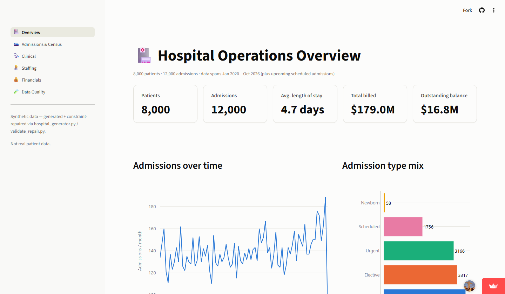
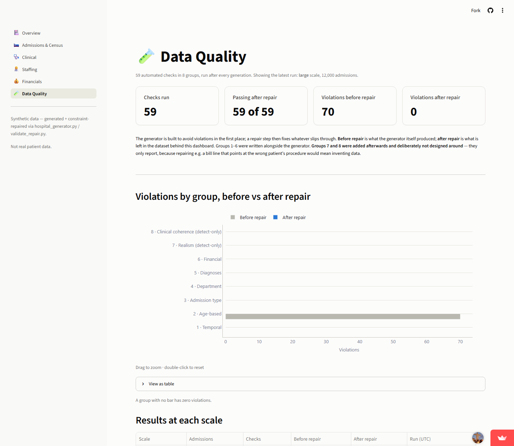

# Synthetic Hospital Database





[](https://opensource.org/licenses/MIT)
[](https://www.python.org/downloads/)
[](https://synthetic-hospital-db.streamlit.app/)

**[Live Demo →](https://synthetic-hospital-db.streamlit.app/)**

*The app runs on Streamlit's free tier and sleeps when idle — if you see a "This app has gone to sleep" screen, click **Yes, get this app back up!** and give it a few seconds.*

**100% synthetic — no real patient data.** A constraint-aware generator for a fully-relational 17-table hospital database (MySQL/MariaDB), a 57-check validation suite with an automatic repair step, and a 6-page dashboard built on top of it — including a Data Quality page that shows the validation results. Built to demonstrate data-engineering and data-quality thinking, not to model any real institution — see [Data Sources & References](docs/CITATIONS.md#synthetic-data-disclosure) for the full disclosure.

## Overview

Most synthetic-data generators produce rows that are individually plausible but collectively wrong: a newborn admitted to Cardiology, a male patient diagnosed with a pregnancy complication, a bill dated before the discharge it covers, a doctor treating patients before they were hired. This project builds a generator that avoids those violations *at generation time*, checks the result with a 57-rule validator, repairs what slips through, and records — with real numbers — what each stage did.

**Real, verified results:**
- 🏥 **17-table relational schema**: departments, staff, patients, admissions, clinical records, and billing — full FK graph, `CHECK` constraints, one polymorphic reference pattern (`staff_shifts.staff_id`)
- 🐛 **A real bug found and fixed**: at small scale, 10 of 20 departments ended up with zero doctors — making a whole violation category *permanently unrepairable*. See [docs/METHODOLOGY.md](docs/METHODOLOGY.md#a-fifth-bug-found-by-testing-at-small-scale).
- 🔍 **The validator was not independent, so I added checks that were**: the original six check groups were written alongside the generator, which was then built to satisfy them — on the generator's earlier output they reported **19** violations. Sixteen realism checks added afterwards (Group 7) found **59,105** in that same dataset: 2,409 patients "currently admitted" (one since 2020), bill lines pointing at other patients' procedures, doctors treating before they were hired. Every one was then fixed in the generator, and the checks now pass on fresh data. See [docs/METHODOLOGY.md](docs/METHODOLOGY.md#second-round-independent-checks).
- 🩺 **Treatments now follow the diagnosis**: procedures, medications and tests used to be drawn at random, so a delivery could land on a male patient and chemotherapy on someone with no cancer diagnosis — **4,699** such contradictions across six checks (Group 8) in the earlier large dataset. The generator now picks treatments from each admission's own diagnoses and the patient's sex and age (`data/clinical_rules.py`); the same six checks find **0** at all three scales. The mapping is coarse and hand-built — it removes contradictions, it is not clinical guidance. See [docs/METHODOLOGY.md](docs/METHODOLOGY.md#third-round-clinical-coherence).
- 🕰️ **Measured against the old generator**: the archived pre-patch generator produced **99,532** violations at large scale (against the 51 checks that existed then), and its output couldn't even be repaired — the repair step crashes on a `CHECK` constraint. The current generator produces 65 (of 57 checks). See [docs/METHODOLOGY.md](docs/METHODOLOGY.md#round-one-what-was-actually-broken).
- 📉 **What each stage leaves behind**, latest recorded run at each scale — "before repair" is what the generator produced by itself:

  | Scale | Admissions | Violations before repair | After repair |
  |---|---|---|---|
  | Small | 800 | 194 | 67 |
  | Medium | 3,200 | 83 | 2 |
  | Large | 12,000 | 65 | 0 |

  What remains at small/medium is one known case — a department with no room suited to a patient's condition. (Earlier versions of this README reported "25,720 → 22" at large scale; roughly 99.7% of that was repair clearing groups the generator didn't yet prevent. The generator now prevents them, so this table no longer flatters repair.)

- 📊 **6-page Streamlit dashboard**, fully self-contained (bundled CSVs, no live DB dependency) — Overview, Admissions & Census, Clinical, Staffing, Financials, Data Quality
- ✅ **Automated tests**: unit tests, CSV-level data tests (run against the shipped data, no database needed), and an end-to-end pipeline test, wired to a GitHub Actions workflow
- 📓 **Three executed notebooks** with real, live-generated output (EDA, a live validation run, and SQL analysis)

## Quick Start

```bash
git clone https://github.com/brianravelo28/synthetic-hospital-db.git
cd synthetic-hospital-db
pip install -r requirements.txt
```

### Run the whole pipeline

Requires a local MySQL or MariaDB server (development used MariaDB 10.4 via [XAMPP](https://www.apachefriends.org/); MySQL 8 is untested).

```bash
mysql -u root < data/hospital_db.sql          # create the schema
python src/run_pipeline.py --size large        # or small / medium
```

That one command generates the data, validates it, repairs it, validates again, and exports everything the dashboard reads (`app/data/*.csv`, including `validation_report.csv`). ⚠️ It **truncates and regenerates every table** in the target database. The connection string comes from `HOSPITAL_DB_URL` (default: `mysql+pymysql://root:@localhost/hospital_db`). Set `HOSPITAL_AS_OF` to pin the run's reference date for a reproducible run.

The individual steps are still importable (`data/hospital_generator.py`, `src/validate_repair.py`, `src/export_to_csv.py`) and the notebooks use them directly.

### Launch the dashboard

```bash
streamlit run app/app.py            # -> http://localhost:8501
```

This step needs no database — it runs straight from the CSVs already committed in `app/data/`. Opening the repo in **GitHub Codespaces** does this automatically (see `.devcontainer/`): it installs the pinned dependencies and starts the dashboard on port 8501, opening it in a browser tab (the embedded preview is blocked by GitHub for private ports). Verified in a Codespace on 2026-10-14. The container has no database, so the pipeline, notebook 02 and the integration tests need a local MySQL/MariaDB instead.

The dashboard reads **only** the exported CSVs, never a live connection — this is what makes it deployable to [Streamlit Community Cloud](https://streamlit.io/cloud) as-is, since a deployed app can't reach a local database. `app/requirements.txt` is a separate, minimal requirements file (just `streamlit`/`pandas`/`plotly`) scoped to the dashboard alone — Streamlit Cloud installs from whichever `requirements.txt` sits next to the app's entry point, and the full pipeline's dependencies (SQLAlchemy, Faker, Jupyter...) have no reason to ship with the deployed app.

### Run the tests

```bash
pip install -r requirements-dev.txt
pytest -m "not integration"          # unit + shipped-data tests; no database needed
```

The integration test runs the whole pipeline against a real database and **regenerates it**, so it only runs when `HOSPITAL_DB_URL` is set explicitly — point it at a scratch database, never the one behind your dashboard:

```bash
HOSPITAL_DB_URL=mysql+pymysql://root:@localhost/hospital_scratch pytest -m integration
```

(The schema file hard-codes the database name `hospital_db`; for a scratch database, load a copy with the name replaced.)

### Explore the notebooks

```bash
jupyter notebook notebooks/
```
- `01_eda_hospital_operations.ipynb` — exploratory analysis of the repaired dataset (admissions trends, department volume, diagnoses, length of stay, financials); reads only `app/data/`, no DB needed
- `02_data_quality_validation.ipynb` — a **live** re-run of the generate → validate → repair cycle at small scale, capturing real before/after numbers (⚠️ truncates and regenerates the database named by `HOSPITAL_DB_URL` — see the notebook's own warning)
- `03_sql_analysis.ipynb` — business questions in **SQL** (joins, window functions, CTEs, the polymorphic `staff_shifts` join, a data-quality rule as a query) against the shipped CSVs loaded into in-memory SQLite, so it needs no database server

## Dashboard

**[→ Try it live](https://synthetic-hospital-db.streamlit.app/)** — no install needed.

6 pages, each browser-verified against the shipped (synthetic) data:

| Page | What it shows |
|---|---|
| **Overview** | Headline KPIs, admissions trend, admission-type mix, department volume, patient condition (acuity) mix |
| **Admissions & Census** | Filterable by date/department/type — admission status, length-of-stay distribution, discharge disposition, triage acuity, day-of-week pattern |
| **Clinical** | Top diagnoses (ICD-10, human-readable names), diagnoses by department, top procedures/medications, test result severity mix |
| **Staffing** | Headcount by department (doctor/nurse/employee), doctor specialties, shift-type distribution, hires per year |
| **Financials** | Revenue by payer type, payment status mix, billing line items by type, avg. bill by admission type, revenue trend |
| **Data Quality** | The 57 checks and their results: violations by group before vs. after repair, results at each scale, what the independent checks found in the pre-fix data, the clinical-coherence before/after, and every rule with a plain-language description |

Design notes (all in `app/utils.py`):
- **KPI stat-tile cards** lead every page, and sit in the same position on each one — on Admissions & Census the KPI row is reserved above the filters and fills in once they're applied.
- **Colors are assigned by category identity** (not chart-local rank or hue-cycling), with true evaluative "status" colors (e.g. payment status, discharge disposition) kept separate from plain categorical identity and from ordinal severity scales.
- **13px minimum font** across the whole dashboard (chart axes, legends, captions, widget labels); long chart labels are wrapped onto at most two lines rather than shrunk.
- **Every zoomable chart carries a "drag to zoom · double-click to reset" hint** (`plot()` in `app/utils.py`).
- **Every chart has a collapsed "View as table" twin** with the numbers behind it, read from the figure itself so the two can't disagree (histograms show summary statistics). Several palette colours (aqua, yellow, magenta) are under 3:1 contrast against the chart background, which the palette validator flags as needing labels or a table view; this is the table view.

## Project Structure

```
synthetic-hospital-db/
├── README.md               # this file
├── requirements.txt
├── requirements-dev.txt     # + pytest
├── pytest.ini
├── LICENSE                  # MIT
├── .gitignore
├── .devcontainer/           # GitHub Codespaces config — installs deps and launches the dashboard
├── .github/workflows/       # CI: unit + shipped-data tests; full pipeline against MariaDB
├── data/                    # schema + constraint-aware generator (the "acquisition" step for synthetic data)
│   ├── hospital_db.sql
│   ├── hospital_generator.py
│   ├── shared_rules.py        # constants + reference date shared by generator and validator
│   ├── clinical_rules.py      # diagnosis -> procedures / drugs / tests, with patient eligibility
│   └── icd10_diagnoses.py
├── src/                     # pipeline: validation/repair, CSV export, one-command runner
│   ├── validate_repair.py
│   ├── export_to_csv.py
│   └── run_pipeline.py
├── tests/                   # unit, shipped-data and end-to-end tests
├── notebooks/               # EDA, data-quality validation, SQL analysis (executed, real outputs)
├── app/                     # Streamlit dashboard (self-contained, bundled CSVs in app/data/)
└── docs/                    # schema reference, methodology, citations, validation_runs/ (recorded results)
```

See [docs/SCHEMA.md](docs/SCHEMA.md) for exact table/column definitions and [docs/METHODOLOGY.md](docs/METHODOLOGY.md) for the full write-up of what was actually broken, how it was diagnosed, and how it was fixed.

## Data Sources

There are no external data sources — every row is synthetically generated (see [docs/CITATIONS.md](docs/CITATIONS.md) for the full disclosure and the coding standards referenced for realism). This is a deliberate design choice: healthcare data carries real privacy stakes, and a portfolio piece has no legitimate reason to touch real PHI.

## Status & Limitations

- **Done**: schema + constraint-aware generator, 57-check validation + repair (recorded at 3 scales), one-command pipeline, CSV export, 6-page dashboard ([deployed on Streamlit Community Cloud](https://synthetic-hospital-db.streamlit.app/)), tests, 3 executed notebooks.
- **CI and versions**: `.github/workflows/ci.yml` runs the unit and shipped-data tests on Python 3.11 and the full pipeline against a MariaDB 10.4 service container; both jobs pass. Dependencies are pinned to exact versions (`requirements.txt`, `app/requirements.txt`), tested together on Python 3.11 — pandas 3 requires 3.11 or newer. Development before that was on Python 3.9 on one Windows machine, which the pins no longer support.
- **The checks measure consistency with rules I wrote, not clinical realism.** Groups 1–6 were written alongside the generator; Groups 7 and 8 were added afterwards, but they are still my idea of what "wrong" looks like. Group 8 catches six hard contradictions between a patient, their diagnoses and their treatments; the diagnosis-to-treatment mapping behind it is a coarse, hand-built table, so an odd-but-not-contradictory pairing can still occur. Ages follow a hand-set curve rather than a real population.
- **Known residual violation**: a department with no room type suited to a patient's condition (small/medium scale). Repair downgrades the recorded condition rather than invent a room.
- **Hospital is mostly empty**: 12,000 admissions over ~6.7 years is about 5 a day, so the census (currently admitted) is small relative to 560 rooms. That is arithmetic, not a bug, but it is not a realistic occupancy.
- **Patient columns like SSN, phone, email and address** are included in `app/data/patients.csv`. They are Faker-generated placeholders (like everything else here), the dashboard doesn't read them, and they're kept deliberately as part of the realistic-looking schema.
- **Reproducible when pinned**: seeds are fixed and the whole pipeline reads one reference date. Set `HOSPITAL_AS_OF` (e.g. `2026-10-13 12:00:00`) and two runs produce identical tables — tested, including that a *different* date gives different tables. Unpinned, "now" is the wall clock, so counts shift slightly between runs. Repair is deterministic and idempotent: re-running it changes nothing.
- **Dashboard data is a static snapshot**: the deployed app reads the CSVs committed in `app/data/`, so it only changes when the pipeline is re-run and the result is pushed — there is no live database behind it.

## License

MIT License — see [LICENSE](LICENSE).
