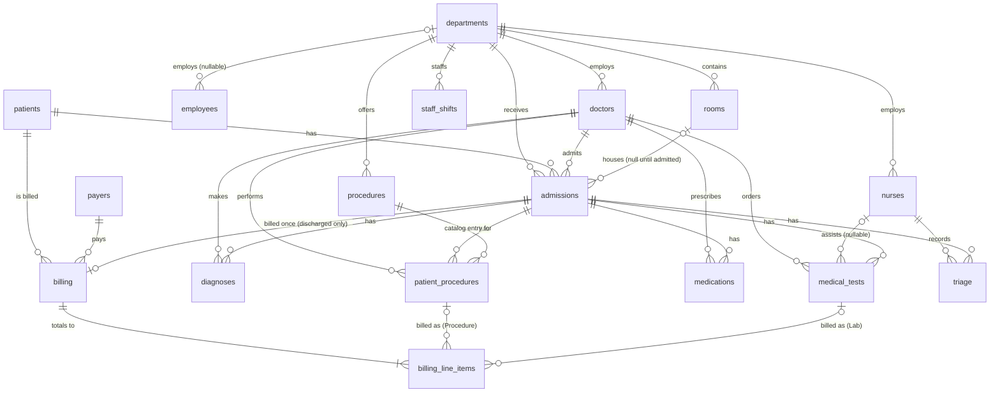
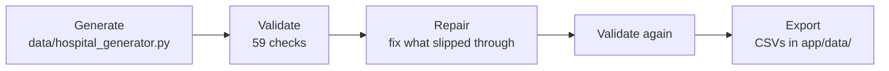

# Synthetic Hospital Database


[](https://opensource.org/licenses/MIT)
[](https://www.python.org/downloads/)
[](https://synthetic-hospital-db.streamlit.app/)

A realistic, fully synthetic hospital database for practising SQL and analytics: 17 related tables covering departments, staff, patients, admissions, clinical records and billing, with no real patient data.

**[Live dashboard →](https://synthetic-hospital-db.streamlit.app/)** *(it runs on Streamlit's free tier and sleeps when idle; if you see "This app has gone to sleep", click **Yes, get this app back up!** and give it a few seconds)*

Most synthetic data looks plausible row by row but falls apart when you join tables: a newborn admitted to Cardiology, a male patient with a pregnancy diagnosis, a bill dated before the discharge it covers. This dataset is generated and checked so the tables agree with each other, so a surprising query result is more likely to come from the query than from the data. For simulated patient lifetimes in standard health-record formats (FHIR, C-CDA, CSV), see [Synthea](https://github.com/synthetichealth/synthea); this dataset is instead one hospital's operational database, with rooms, beds, staff and billing, built for SQL practice.

## What's included

- **The dataset:** one year of admissions at a large hospital (12,000 admissions, 8,000 patients, about 200,000 rows in all) as CSV files in [`app/data/`](app/data/), plus `icd10_lookup.csv` (diagnosis names).
- **The schema:** `data/hospital_db.sql` creates the 17 tables in MySQL or MariaDB with keys and `CHECK` constraints (rules the database enforces on every row). [docs/SCHEMA.md](docs/SCHEMA.md) describes each table.
- **18 practice questions** with solutions, from a single table up to window functions and data-quality checks: [practice/](practice/).
- **A dashboard** of six pages of charts you can zoom, each with a table view of the numbers behind it.
- **A generator** that builds the data, so you can make your own at three sizes (below).
- **Three executed notebooks:** exploratory analysis, a live data-validation run and worked SQL examples.



*`staff_shifts.staff_id` points at a doctor, a nurse or an employee depending on `staff_type`, so it is not a real foreign key.* Exact columns are in [docs/SCHEMA.md](docs/SCHEMA.md).

## Practice questions

[`practice/questions.md`](practice/questions.md) has 18 questions with difficulty levels, skills and hints, and [`practice/solutions.sql`](practice/solutions.sql) has the answers (kept separate so they don't spoil the questions). They cover joins and dates, window functions (`ROW_NUMBER`, `LAG`, `PERCENT_RANK`), CTEs and recursive date series, the `staff_shifts` join, and four data-quality checks that should return no rows. The solutions are written for SQLite; [`practice/mysql_notes.md`](practice/mysql_notes.md) covers MySQL and MariaDB.

## Quick start

**Option 1: practise SQL with no server.** This builds a SQLite database from the shipped CSVs:

```bash
git clone https://github.com/brianravelo28/synthetic-hospital-db.git
cd synthetic-hospital-db
pip install pandas
python practice/load_sqlite.py       # writes practice/hospital.db
sqlite3 practice/hospital.db         # or open it in any SQLite client; then try practice/questions.md
```

**Option 2: generate your own data (needs MySQL or MariaDB).** Development used MariaDB 10.4 via [XAMPP](https://www.apachefriends.org/); MySQL 8 is untested. Only the large size ships as CSVs; small (800 admissions) and medium (3,200) exist only if you generate them.

```bash
pip install -r requirements.txt
mysql -u root < data/hospital_db.sql                 # create the schema
python src/run_pipeline.py --size large              # or small / medium
```

⚠️ The pipeline **truncates and regenerates every table** in the target database. It generates the data, validates it, repairs it, validates again, and exports everything the dashboard reads to `app/data/`. The connection string comes from `HOSPITAL_DB_URL` (default `mysql+pymysql://root:@localhost/hospital_db`). Set `HOSPITAL_AS_OF` (for example `2026-10-13 12:00:00`) to pin the date the data is generated "as of", for a reproducible run. Small and medium sizes are sparse: every department needs a few rooms, so at 800 admissions the hospital is mostly empty (about 15% bed occupancy at small, 44% at medium, 63% at large).

**The dashboard** needs no database; it reads the CSVs in `app/data/`:

```bash
pip install -r requirements.txt
streamlit run app/app.py             # → http://localhost:8501
```

Opening the repo in **GitHub Codespaces** does this for you (see `.devcontainer/`): it installs the pinned dependencies and starts the dashboard on port 8501, in a browser tab (GitHub blocks the embedded preview for private ports). The container has no database, so the pipeline needs a local MySQL or MariaDB instead.

## How the data is built

Each dataset goes through four steps:



The generator is written to avoid contradictions up front. A validator then runs 59 consistency checks, and where something slips through, a repair step corrects the rows. Three examples show the three outcomes:

- **Prevented by the generator.** `bill_before_discharge`: bills exist only for discharged stays and are dated 0 to 90 days after discharge, so the validator finds 0 violations at every size and repair has nothing to do.
- **Fixed by repair.** `newborn_wrong_registered_date`: patients are created before their admissions exist, so a newborn's registration date cannot match the admission date when it is first drawn. At large size 70 rows violate the rule before repair and 0 after (2 and 21 at small and medium).
- **Reported, never repaired.** The realism and clinical checks (for example, chemotherapy with no cancer diagnosis) have no repair, because fixing one would mean inventing a diagnosis or a bill. The generator is built to avoid them, and the checks confirm it did: 0 violations at every size.

The data covers the last 365 days. Rooms are sized from each department's expected load and patients are placed in date order, so a room never holds more patients than it has beds and a patient is never in two beds at once. How this works, and what it costs, is in [docs/METHODOLOGY.md](docs/METHODOLOGY.md). To run the cycle live, see notebook 02 (it overwrites the database named by `HOSPITAL_DB_URL`).

## How it's checked

The data is checked against 59 consistency rules in eight groups, covering dates, ages, admission types, departments, diagnoses, money, operational realism and clinical coherence. Each is a SQL query that counts violations; practice questions 15 to 18 are queries of the same kind. At all three sizes there are no violations after repair. The rules are ones I wrote, so they test internal consistency, not clinical realism. The groups are listed in [docs/METHODOLOGY.md](docs/METHODOLOGY.md#the-59-checks), together with what each round of fixes found and measured.

## Dashboard

**[→ Try it live](https://synthetic-hospital-db.streamlit.app/)**: no install needed. Six pages of charts you can zoom, each with a "View as table" of the numbers behind it:

| Page | What it shows |
|---|---|
| **Overview** | Headline KPIs, admissions trend, admission-type mix, department volume, patient condition mix |
| **Admissions & Census** | Filterable by date, department and type: admission status, length of stay, discharge disposition, triage acuity, day-of-week pattern, and bed occupancy (daily census, occupancy by room type) |
| **Clinical** | Top diagnoses (ICD-10, the International Classification of Diseases, with readable names), diagnoses by department, top procedures and medications, test result severity |
| **Staffing** | Headcount by department, doctor specialties, shift types, hires per year |
| **Financials** | Revenue by payer type, payment status, billing line items, average bill by admission type, revenue trend |
| **Data Quality** | The 59 checks and their results: violations by group before and after repair, results at each size, what the independent checks found, and every rule in plain language |

Layout and colour decisions are in [docs/DASHBOARD.md](docs/DASHBOARD.md).

## Tests

The tests check that the data and the pipeline stay correct and repeatable: that the generated data obeys its rules, that the calculations give the right numbers, and that the same inputs give the same output. If a change breaks any of that, a test fails. A few examples:

- **Rules:** no delivery on a male patient, no chemotherapy without a cancer diagnosis, no room holding more patients than it has beds, no patient in two stays at once.
- **Reproducibility:** with the reference date pinned, two runs give identical tables and a different date gives different tables; running repair twice changes nothing.
- **Practice set:** every solution runs, and the four data-quality solutions return no rows.
- **Dashboard helpers:** the census calculation, and the table view built under each chart.

```bash
pip install -r requirements-dev.txt
pytest -m "not integration"          # no database needed
```

The integration tests run the whole pipeline against a real database and **regenerate it**, so they run only when `HOSPITAL_DB_URL` is set explicitly. Point it at a scratch database, never the one behind your dashboard (the schema file hard-codes the name `hospital_db`; for a scratch database, load a copy with the name replaced):

```bash
HOSPITAL_DB_URL=mysql+pymysql://root:@localhost/hospital_scratch pytest -m integration
```

The tests do not cover page layout or the live deployment. GitHub Actions runs them on every push (Python 3.11, and a MariaDB 10.4 service container for the integration tests).

## Notebooks

```bash
jupyter notebook notebooks/
```

- `01_eda_hospital_operations.ipynb`: exploratory analysis of the dataset (admissions trends, department volume, diagnoses, length of stay, financials); reads only `app/data/`
- `02_data_quality_validation.ipynb`: a live re-run of generate, validate, repair at small size, with real before and after numbers (⚠️ it truncates and regenerates the database named by `HOSPITAL_DB_URL`)
- `03_sql_analysis.ipynb`: worked SQL examples (joins, window functions, CTEs, the `staff_shifts` join, a data-quality rule as a query) over the CSVs loaded into in-memory SQLite, with each answer shown

## Limits

- **Everything is synthetic.** Distributions come from the generator's settings, not from real hospitals, so a finding such as "Emergency Medicine has the most admissions" describes this dataset, not the real world. The 66 diagnosis codes are real ICD-10 codes with hand-assigned weights; no real prevalence data was used.
- **Treatments are plausible, not clinical.** Procedures, medications and tests are chosen from each admission's diagnoses and the patient's sex and age through a coarse, hand-built table. It removes hard contradictions (no chemotherapy without cancer, no delivery on a male patient); it is not clinical guidance, and an odd-but-not-contradictory pairing can still occur.
- **Occupancy has side effects.** Keeping rooms within capacity means about 1 in 5 admissions starts when a bed frees, not at the drawn time, and a small share of patients are recorded at a lower level of care than drawn.
- **The checks are rules I wrote**, so they cannot show that the data is realistic.
- **The dashboard is a snapshot.** It reads the CSVs committed in `app/data/`; it changes only when the pipeline is re-run and the result is pushed.

## Project structure

```
synthetic-hospital-db/
├── README.md
├── requirements.txt          # exact versions, tested together on Python 3.11
├── requirements-dev.txt      # + pytest
├── pytest.ini
├── LICENSE                   # MIT
├── .devcontainer/            # GitHub Codespaces config: installs dependencies, launches the dashboard
├── .github/                  # CI workflow; Dependabot configuration
├── data/                     # the generator and its rules
│   ├── hospital_db.sql           # MySQL/MariaDB schema
│   ├── hospital_generator.py     # builds the data
│   ├── shared_rules.py           # constants and the reference date shared by generator and validator
│   ├── clinical_rules.py         # diagnosis → plausible procedures, drugs and tests
│   ├── occupancy.py              # room sizing and allocation
│   └── icd10_diagnoses.py        # the 66 ICD-10 codes and their weights
├── src/                      # the pipeline
│   ├── validate_repair.py        # the 59 checks and the repairs
│   ├── export_to_csv.py          # database → CSVs
│   └── run_pipeline.py           # generate → validate → repair → validate → export
├── practice/                 # SQL practice questions, solutions and a SQLite loader
├── tests/
├── notebooks/
├── app/                      # the Streamlit dashboard (reads the CSVs in app/data/)
└── docs/                     # SCHEMA, METHODOLOGY, DASHBOARD, CITATIONS, validation_runs/ (recorded results)
```

See [docs/CITATIONS.md](docs/CITATIONS.md) for the data disclosure: there are no external data sources, and every row is synthetic. Healthcare data carries real privacy stakes, and this project has no reason to touch real patient records.

## License

MIT License. See [LICENSE](LICENSE).
