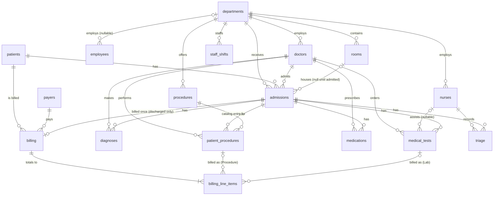

# Data Schema

Full DDL with constraints, indexes, and inline column comments: [`data/hospital_db.sql`](../data/hospital_db.sql). This file is a navigable summary, not a replacement for it.

17 tables, InnoDB, generated in four dependency domains (reference → staff/facilities → clinical → financial). Primary/foreign keys below use the table's own ID convention (`ADM-######`, `PAT-######`, etc.), generated by `gen_id()` in `hospital_generator.py`.

## Entity-relationship diagram

`staff_shifts.staff_id` has no line to `doctors`/`nurses`/`employees` because it is a **polymorphic reference** (which table it points into depends on `staff_type`), so it can't be a foreign key. Every other line above is a real foreign key in `data/hospital_db.sql`.

## Domain 1 — Reference tables

| Table | Key columns | Notes |
|---|---|---|
| `departments` | `department_id` (PK), `dep_name`, `floor_number`, `bed_capacity` | 20 fixed departments. Referenced by almost every other table. `bed_capacity` is the number of inpatient beds, set by the generator to the sum of the beds in the department's inpatient rooms. |
| `payers` | `payer_id` (PK), `payer_name`, `payer_type` (ENUM), `contact_phone` | 10 payers across 6 `payer_type` values (Medicare, Medicaid, Private Insurance, Self-Pay, Workers Compensation, CHIP), each with a fixed coverage rate in the generator/repair scripts. |
| `procedures` | `procedure_id` (PK), `procedure_code`, `procedure_name`, `department_id` (FK), `base_cost`, `duration_minutes` | 30-procedure catalog, CPT-style codes. |

## Domain 2 — Staff & facilities

| Table | Key columns | Notes |
|---|---|---|
| `patients` | `patient_id` (PK), `birth_date`, `age`, `gender` (M/F/NB), `blood_type`, `registered_date` | `age` is stored, not computed — generator/repair keep it consistent with `birth_date`. No FK dependencies. |
| `doctors` | `doctor_id` (PK), `specialty`, `department_id` (FK), `hire_date` | `specialty` drives department assignment via `SPECIALTY_TO_DEPARTMENT` in the generator. Every department is guaranteed at least one doctor (see [METHODOLOGY.md](METHODOLOGY.md)). |
| `nurses` | `nurse_id` (PK), `position`, `department_id` (FK), `hire_date` | `position` drives department assignment via `NURSE_POSITION_TO_DEPARTMENT`. |
| `employees` | `employee_id` (PK), `position`, `department_id` (FK, nullable), `salary` | Non-clinical staff; `department_id` is `NULL` for hospital-wide roles (IT, HR, etc.). |
| `rooms` | `room_id` (PK), `room_type` (ENUM), `department_id` (FK), `status` | 8 room types (Standard, Private, ICU, NICU, OR, ER, Recovery, Isolation) with `bed_capacity` per room (Standard 2, Private 1, ICU 1, NICU 1, Isolation 1, ER 2, Recovery 2, OR 1). Standard, Private, ICU, NICU and Isolation rooms are inpatient beds; OR, ER and Recovery rooms are procedure and visit spaces and never hold an admission. Rooms are sized from each department's expected patient load, every department has at least one Standard and one ICU room, and `status` shows `Occupied` for rooms holding a currently admitted patient. |

## Domain 3 — Clinical

| Table | Key columns | Notes |
|---|---|---|
| `admissions` | `admission_id` (PK), `patient_id`/`admitting_doctor_id`/`department_id`/`room_id` (FKs), `admission_date`, `discharge_date`, `admission_type` (ENUM), `admission_status` (ENUM), `discharge_disposition` (ENUM), `patient_condition` (ENUM, ordered severity), `length_of_stay` | The central table — almost everything else hangs off `admission_id`. `admission_status = Scheduled` means no room yet; `Scheduled` admissions are future-dated; `Admitted` means the stay hasn't ended yet (decided by dates); `Cancelled`/`Scheduled` admissions carry no downstream clinical or billing records (prevented at generation, and still enforced by repair). |
| `triage` | `triage_id` (PK), `admission_id` (FK), `nurse_id` (FK), vitals, `acuity_level` | One record per admission (≈80% of admissions get one). `acuity_level` is the Emergency Severity Index (ESI), 1 = most critical, 5 = least urgent. |
| `diagnoses` | `diagnosis_id` (PK), `admission_id`/`doctor_id` (FKs), `icd10_code`, `diagnosis_type` (Primary/Secondary/Tertiary/Complication) | ICD-10-CM codes from `icd10_diagnoses.py` (66 curated codes across 13 clinical categories, with hand-assigned relative weights: author's judgement of how common each is, not real prevalence data). |
| `patient_procedures` | `patient_procedure_id` (PK), `admission_id`/`procedure_id`/`doctor_id` (FKs), `procedure_status` | Junction table, admissions × procedure catalog. |
| `medications` | `medication_id` (PK), `admission_id`/`doctor_id` (FKs), `drug_name`, `dosage`, `frequency`, `start_date`/`end_date`, `med_status` | 33-drug catalog with standard clinical dosing notation (QD/BID/TID/QID/PRN). |
| `medical_tests` | `test_id` (PK), `admission_id`/`doctor_id` (FKs), `nurse_id` (FK, nullable), `test_category` (ENUM), `result`, `cost` | 7 test categories (Blood Panel, Urinalysis, Imaging, Pathology, Cardiology, Microbiology, Neurology). |
| `staff_shifts` | `shift_id` (PK), `staff_id`, `staff_type` (ENUM: Doctor/Nurse/Employee), `department_id` (FK), `shift_type`, `hours_worked` | `staff_id` is a **polymorphic reference** — it points into `doctors`, `nurses`, or `employees` depending on `staff_type`, so it can't be a hard FK. Join with a `CASE` on `staff_type`. |

## Domain 4 — Financial

| Table | Key columns | Notes |
|---|---|---|
| `billing` | `bill_id` (PK), `admission_id` (FK, UNIQUE — one bill per admission), `patient_id`/`payer_id` (FKs), `bill_date`, `total_amount`, `insurance_covered`, `patient_responsibility`, `payment_status` (ENUM) | Bills exist only for **discharged** admissions, dated 0–90 days after discharge (never in the future). `total_amount` is the sum of the bill's line items. |
| `billing_line_items` | `line_item_id` (PK), `bill_id` (FK), `item_type` (ENUM: Procedure/Medication/Room/Lab/Consultation), `patient_procedure_id`/`test_id` (FKs, populated only for their matching `item_type`), `unit_cost`/`quantity`/`total_cost`/`covered_amount` | Built bottom-up from the bill's *own admission*: its room stay, completed procedures, tests, medications and an optional consultation — so a procedure/lab line always points at that admission's own procedure/test. `billing.total_amount` = `SUM(total_cost)`. |

## Exported CSVs (`app/data/`, produced by `src/run_pipeline.py` / `src/export_to_csv.py`)

One CSV per table above, plus `icd10_lookup.csv` (`icd10_code` → `diagnosis_name`, built from `icd10_diagnoses.py`) so the dashboard can show human-readable diagnosis names without a DB join.

Validation outputs written alongside them by `src/run_pipeline.py` (read by the Data Quality page):

| File | Contents |
|---|---|
| `validation_report.csv` | One row per check (59): group, rule, violations before repair, violations after repair |
| `validation_report_meta.json` | Scale, run time, admission count, totals |
| `validation_runs.csv` | One line per scale (small / medium / large): the latest recorded run |
| `validation_baseline_pre_fix.csv` | The 51 checks run against the dataset produced *before* the realism fixes (a fixed historical artifact, not regenerated) |
| `validation_baseline_pre_coherence.csv` | The six Group 8 clinical-coherence checks run against the large dataset produced *before* treatments followed diagnoses (4,699 violations; a fixed historical artifact) |
| `validation_baseline_pre_occupancy.csv` | The room and patient overlap checks run against the one-year, sized hospital before they were enforced: `room_double_booked` with rooms assigned the old way (a random suitable room, no capacity check), `census_exceeds_bed_capacity` on the same data, and `patient_overlapping_admissions` before the fix (a fixed historical measurement at large size) |
